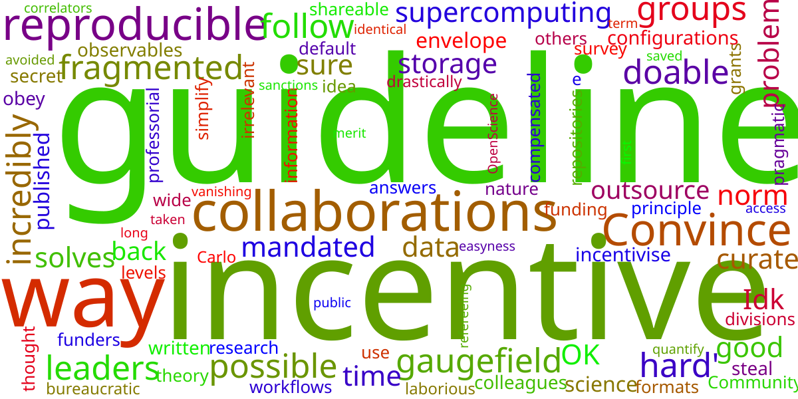
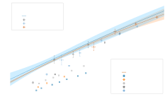
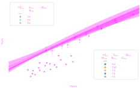
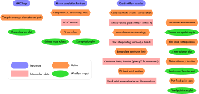
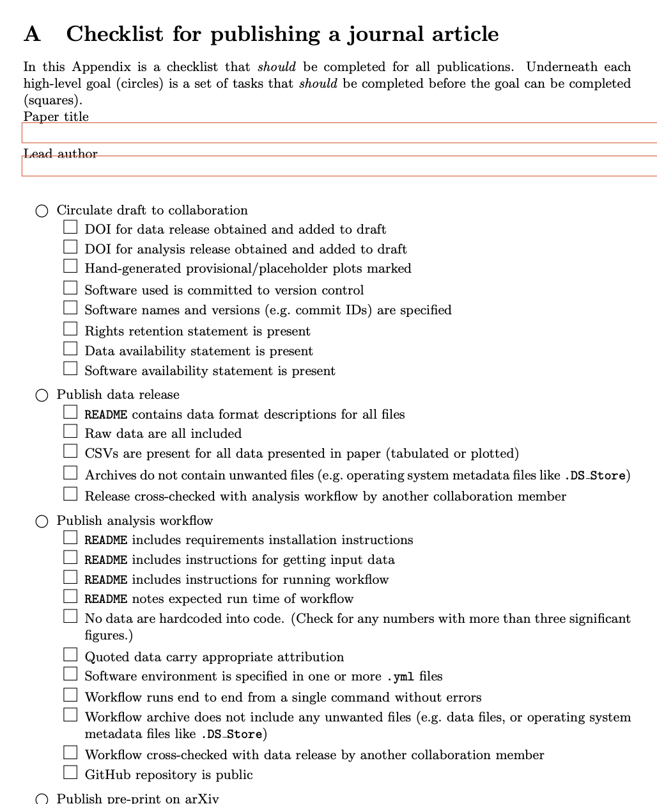
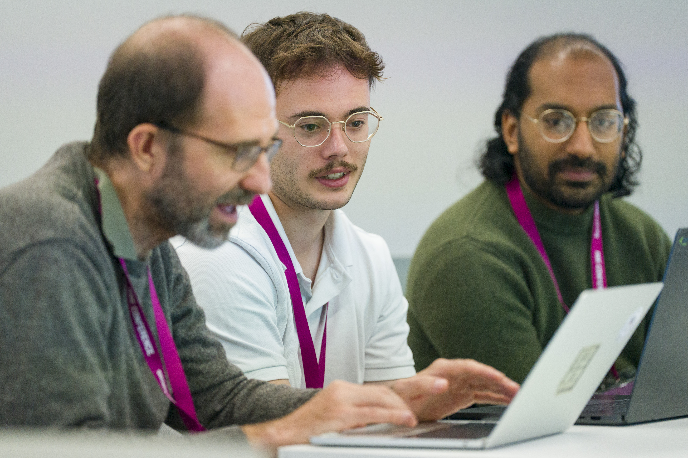
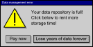
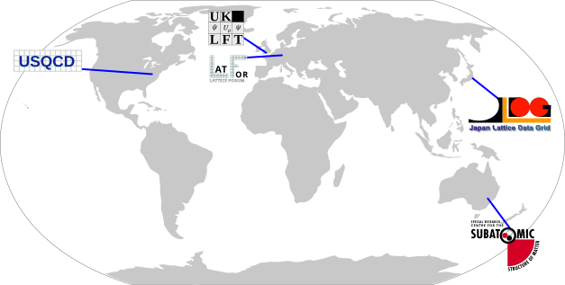

# History and Motivation

-

[ <!-- .element: width="1000px" -->](https://commons.wikimedia.org/wiki/File:Statues_of_Isaac_Newton_and_Gottfried_Leibniz.jpg)

Notes:
Newton and Leibniz both claimed to invent calculus,
but also created a fractious argument as to whether one stole from the other;
it took centuries for us to work out that most likely both invented it independently.
The culture of seventeenth century science
placed more emphasis on securing your next job,
by revealing just enough information to seem clever enough
for someone to pay you to explain the details.

-

 <!-- .element: width="700px" -->

Notes:
But this culture was starting to shift with the foundation of the Royal Society.
Their motto,
"*nullius in verba*"
("don't take anyone's word for it"),
encouraged not trusting any published result as true until it could be reproduced.

-

Process $\rightarrow$ Data $\rightarrow$ Analysis $\rightarrow$ Results

Notes:
Part of this was codifying the basic structure of a scientific paper:
we define a process,
that we carry out and collect data,
which we present and on which we perform an analysis,
for which we present all relevant steps,
leading to results,
which we show and from which we draw conclusions.

-

 <!-- .element: width="1200px" -->

Notes:
Introducing computers into this process can complicate it,
however.

-

 <!-- .element: width="1800px" -->

Notes:
We can do far more in an analysis than we could do by hand,
so we can't fit a complete, precise, and reproducible description of what we've done
into a paper.

-

<!--Process $\rightarrow$ ⬛ $\rightarrow$ 🪄 $\rightarrow$ ✨Results✨-->

 <!-- .element width="550px" -->

Notes:
While in principle,
computers are deterministic,
so could lead to improved reproducibility,
what can instead happen is that the analysis is not described in enough depth to reproduce it.

-

## Reproducibility

<span class="fragment fade-in" data-fragment-index="1">Same data</span>
<span class="fragment fade-in" data-fragment-index="2">$+$ same analysis</span>
<span class="fragment fade-in" data-fragment-index="3">$\rightarrow$ Same results</span>

<span class="fragment fade-in" data-fragment-index="4">(from [The Turing Way project](https://the-turing-way.netlify.app/reproducible-research/overview/overview-definitions.html))</span>

Notes:
It's worth defining what I mean by "reproducibility" at this point.
Reproducible means being able to take the same data,
apply the same analysis procedure,
and reach the same results.
This appears trivial;
without it it's questionable as to whether we're doing science.
But a large amount of work falls short,
particularly when you require _others_ to be able to reproduce the work
without the benefit of having done it previously.

-

## Open Science

The movement to make all research accessible to all levels of society.

 <!-- .element width="200px" -->&nbsp;&nbsp;&nbsp;&nbsp;&nbsp;&nbsp;&nbsp;
[ <!-- .element width="200px" -->](https://www.publicdomainpictures.net/en/view-image.php?image=302908&picture=filling-up-the-test-tube)&nbsp;&nbsp;&nbsp;&nbsp;&nbsp;&nbsp;&nbsp;
 <!-- .element width="200px" --> &nbsp;&nbsp;&nbsp;&nbsp;&nbsp;&nbsp;&nbsp;  <!-- .element width="200px" -->

Notes:
Open science in particular makes it much easier for work to be reproducible by others.

---

# Lattice

-

<div style="width: 40%; float: left; margin-top: 150px; margin-left: 40px;">
$$\begin{align*}\mathcal{L}_\mathrm{QCD} &= \bar{\psi}_i \left( i \gamma^\mu (D_\mu)_{ij} - m\, \delta_{ij}\right) \psi_j \\ &- \frac{1}{4}G^a_{\mu \nu} G^{\mu \nu}_a\end{align*}$$
</div>

<div style="width: 49%; float: right;" class="fragment">

 <!-- .element width="400px" -->

</div>

Notes:
Particle physics is defined by Lagrangian functions like this.
We need to solve these to predict the behaviour of particles at the smallest length scales,
and the highest energy scales,
to understand the nature, origin, and fate of the Universe.
[click]
To solve these equations requires non-perturbative functional integrals,
which cannot be done analytically;
as such,
we introduce a grid of points in the four-dimensional space time as a regulator,
and solve the discretised version of the problem,
which ends up as a very large Monte Carlo integral.

-

 <!-- .element width="1200px" -->

Notes:
To oversimplify,
a lattice computation has three main stages.
First,
a relatively small number of input parameters
are used to generate a large number of Monte Carlo samples of spacetime.
These are stored so that they can be used in multiple different computations.
This uses a substantial amount of HPC resource.
Subsequently,
these stored samples are used to compute one or more observables of interest;
this still requires HPC resources.
(We call this step "measurement".)
Finally,
we take the output of the measurement step,
and do statistics and fits and other analysis techniques
to obtain the numbers that we wish to present in our work,
and plot and tabulate them.
The reproducibility of the first two steps has long been a focus of development;
we largely use open-source community software,
making use of deterministic random number generation
that stores the state as part of its checkpoint.
My focus recently has been on the last stage,
which is often described by no more than a few lines of narrative.

-

 <!-- .element width="1200px" -->

&mdash;[EB, PoS LATTICE2022 (2023) 337](https://doi.org/10.22323/1.430.0337)

Notes:
I surveyed every preprint submitted to the hep-lat arXiv category in 2021,
which is approximately every paper written in lattice that year.
The vast majority of work does not specify what software was used for data analysis.

-

 <!-- .element width="1200px" -->

&mdash;[EB, PoS LATTICE2022 (2023) 337](https://doi.org/10.22323/1.430.0337)

Notes:
In the same survey,
a vanishingly small proportion actually publish
even part of the workflow used for the analysis.
Anyone looking to reproduce the work
would need to rewrite it from scratch based on the narrative;
the time requirement for this is immense,
and the likelihood of getting the same result very small.

-

 <!-- .element width="1000px" -->

&mdash;[EB et al., PoS LATTICE2022 (2023) 341](https://doi.org/10.22323/1.430.0341)

Notes:
A 2022 community survey indicates that
a lack of guideance is a primary reason for
the lack of emphasis on reproducibility of data analysis.
Based on this,
one piece of work I have pursued recently is
developing a reproducibility guide for our collaboration,
with an ambition for it to also be applicable to other collaborations.

---

# Selections from the guide

- [arXiv:2504.01876](https://arxiv.org/abs/2504.01876)
- [doi:10.5281/zenodo.15126671](https://doi.org/10.5281/zenodo.15126671)
- [github.com/telos-collaboration/strategy](https://github.com/telos-collaboration/strategy)

Notes:
The full guide is over thirty pages,
so there's no way I can go through everything now.
But a couple of things are worth highlighting.

-

<!-- .element data-transition="slide-in fade-out" -->

## Share all presented data

<div style="width: 59%; float: left;">

 <!-- .element width="700px" -->

</div>

<div style="width: 40%; float: right;">

</div>

Notes:
When we plot data,
it's useful for people to be able to make use of them.
If they are only on a plot,
then it's hard;
people have to go through with a ruler and read off numbers.

-

<!-- .element data-transition="fade-in slide-out" -->

## Share all presented data

<div style="width: 59%; float: left;">

 <!-- .element width="700px" -->

</div>

<div style="width: 40%; float: right;">

<p style="text-align: center; width: 100%; color: lightgrey; font-family: monospace; margin-bottom: -20px; font-size: 24pt">ensemble_data.csv</p>

```csv
group_family,Nc,Nt,Ns,NF,NAS,NS,NADJ,name,beta,mass,Ls,alpha,a5,M5,mpv,n_traj,plaq,plaq_err,tau_plaq,tau_plaq_err,acceptance,n_cfg_plaq,mres,mres_err,chi2_mres,n_cfg_mres,tau_mres,tau_mres_err,mps,mps_err,chi2_ps,n_cfg_spectrum,mv,mv_err,chi2_v,fps,fps_err,chi2_fps,Z_A,Z_A_err,chi2_Z,w0,w0_err,tau_w0,tau_w0_err
Sp,4,32,16,2,0,0,0,MB74M6Sc1,7.4,0.06,8,1.25,1.0,1.8,1.0,1239,0.5893135293801479,3.66836886036758e-05,0.38959880336360436,0.1361248072012729,0.9454697986577181,69,0.004594603947450405,4.331809633797598e-05,0.6880767738219612,69,1.0684826638602325,0.3145679138383045,,,,,,,,,,,,,,,,,
Sp,4,32,16,2,0,0,0,MB74M6Sc2,7.4,0.06,8,1.5,1.0,1.8,1.0,1142,0.5882991744901003,3.924964346521274e-05,0.7040456297041972,0.30034874004358486,0.9523373052245646,62,0.0032324669485380357,3.954380289326458e-05,1.6694206116710433,63,0.8780990332763267,0.24510646018598964,,,,,,,,,,,,,,,,,
Sp,4,32,16,2,0,0,0,MB74M6Sc3,7.4,0.06,8,1.75,1.0,1.8,1.0,1103,0.5877364583074955,3.241210384086783e-05,0.6420775919132075,0.18513322497785087,0.9523350987000482,90,0.002770255685862103,3.790693661592641e-05,1.1105490176698745,89,0.6009661643038672,0.15355630663914607,0.4779807763806315,0.002338321635952246,0.0021517277022219763,90,,,,,,,,,,,,,
...
```

<p style="text-align: center; width: 100%; color: lightgrey; font-family: monospace; margin-bottom: -20px; font-size: 24pt">fit_parameters.csv</p>

```csv
observable,fit_family,fit_stage,n_points_used,chi2,dof,chi2_dof,chi2_boot_mean_dof,chi2_boot_mean_dof_err,m_M_chi_sq,m_M_chi_sq_err,L_m_M,L_m_M_err,Q_m_M,Q_m_M_err,W_m_M,W_m_M_err,R_m_M,R_m_M_err,C_m_M,C_m_M_err,n_bootstrap_copies,ensemble_names
mv,MDWF,central_nonlinear,15,3.1371306866577524,11,0.2851936987870684,,,0.39391210217591094,0.049484600458483095,2.803072672361306,0.8667495674108029,-0.5312390791226432,0.5904929564926705,,,-0.1806819773373779,0.05961501306922836,,,,MB74M2Sp | MB74M3Sp | MB74M4Sp | MB74M5Sp | MB74M6Sp | MB75M2Sp | MB75M3Sp | MB75M4Sp | MB75M5Sp | MB75M6Sp | MB76M2Sp | MB76M3Sp | MB76M4Sp | MB76M5Sp | MB76M6Sp
mv,MDWF,bootstrap_summary,15,,11,,1.2454167763436308,0.5531231330324479,0.3943743026216772,0.05042617714962322,2.9078974215236797,0.9379069833981151,-0.5966455650624641,0.6408531478037456,,,-0.18055826715331544,0.05672634366118479,,,200,MB74M2Sp | MB74M3Sp | MB74M4Sp | MB74M5Sp | MB74M6Sp | MB75M2Sp | MB75M3Sp | MB75M4Sp | MB75M5Sp | MB75M6Sp | MB76M2Sp | MB76M3Sp | MB76M4Sp | MB76M5Sp | MB76M6Sp
mv,Wilson,central_nonlinear,20,11.371346470847449,13,0.8747189592959577,,,0.37017904970115123,0.014700315839854988,2.9223664029301513,0.3243811825803074,-0.5064047822207849,0.46890194257682183,-0.33203626874673314,0.029324932891179746,0.12697888848183003,0.023042316366379722,-0.13777284985511823,0.0673465857562037,,
...
```

</div>

Notes:
Instead,
it's very helpful to take any number used in a plot
and make it available as a CSV file.
This includes not only points and error bars,
but also fit parameters and coefficients of any other curves.

-

## Croucher’s law

*“I am an idiot and I will make mistakes”*

&mdash;[Mike Croucher](https://mikecroucher.github.io/MLPM_talk/)

Notes:
Mike Croucher was one of the first set of Research Software Engineer Fellows,
and in trying to drive better software engineering in research,
he coined Croucher's law.
A principle underpinning all computational reproducibility
is the need to work from the assumption that we will make mistakes.
So any place we can engineer out the possibility for human error
is a place where reproducibility will be increased.

-

## Use a workflow manager

 <!-- .element height="500px" -->

See also: Gaurav Ray's poster

Notes:
Most analysis processes have many steps,
each of which must be repeated for multiple sets of input data,
meaning there are many moving parts.
While it is possible to write a shell script or other program that takes care of this,
using existing workflow management tooling makes it much easier to do this efficiently.

-

## Independent verification

[ <!-- .element height="300px" -->](https://codecheck.org.uk)

Notes:
While we didn't invent CodeCheck,
we did converge on a very similar collaboration-internal process by coincidence.
Each workflow we publish is tested by another collaboration member,
using only the documentation present,
with no additional guidance from the author,
who then verifies that the results produced
match those that will be in the corresponding paper.

-

## Use checklists

 <!-- .element height="600px" -->

Notes:
Check lists are an important technique
to ensure that necessary steps are taken or requirements met.
Given the number of small things that need to be in place 
for an open, reproducible workflow,
we employ a checklist that must be completed for each publication.

---

# Challenges

-

 <!-- .element height="600px" -->

&mdash;[Society of Research Software Engineering/Dominic Lipinski, CC BY-NC](https://photos.google.com/share/AF1QipPvtI7RfkOMu4K6nL-dTa8VidWtqp5TBLRKurXVNrQjm4Cvm2jfauXxhZM7qdYiLQ)

Notes:
It's all very well to have a long list of rules and guidelines,
but dumping a thirty-page PDF on someone
and expecting them to internalise the content
and apply every sentence in their own work...
is not reasonable.
Particularly,
when working with new research students,
but also with others,
it is one thing to read and agree with the principles,
and another to apply them.
Supervision and mentoring of students' software and workflows
is as important as supervision of their scientific output.
I have a weekly meeting with each of my students,
where we review software, workflows, and their reproducibility.

-

<!-- .element data-background-color="teal" -->

 <!-- .element height="400px" -->

Notes:
Institutional repositories aren't set up to deal with
disciplines that generate large volumes of data.
Even the post-HPC data for some work in lattice is larger than
services like Zenodo will allow in a single record.
This requires data to be thinned or otherwise processed before sharing,
reducing the end-to-end reproducibility.

-

<!-- .element data-background-color="white" -->

 <!-- .element height="80px" -->

 <!-- .element height="400px" -->

Notes:
For sharing larger field configuration data,
the lattice community has developed the International Lattice Data Grid,
which defines interoperable metadata and middleware standards for data sharing.
However,
converging on metadata schemata is hard,
and this process has only been completed for the largest,
easiest-to-specify data.

---

## Summary

- Reproducibility is hard; the alternative is worse
- Don't let the perfect be the enemy of the good
- The guide is available:
  - [GitHub: telos-collaboration/strategy](https://github.com/telos-collaboration/strategy)
    (working copy)
  - [arXiv:2504.01876](https://arxiv.org/abs/2504.01876)
  - [doi:10.5281/zenodo.15113709](https://doi.org/10.5281/zenodo.15113709)
